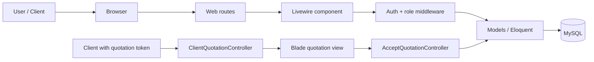

# Project Information: Quotation

## 1. Project overview

This project is a Laravel 13 application for managing studio quotation workflows. It is built around a multi-studio model where each studio has its own pricing catalog, portfolio, branding, template terms, and quotation records. The application supports:

- a super-admin layer for managing studios
- studio-admin and staff users tied to a specific studio
- quotation creation, editing, duplication, filtering, and deletion
- public client-facing quotation pages with token-based access
- online quotation acceptance with signed approval
- email and notification hooks for viewed / accepted events

The actual implementation uses Laravel + Livewire for browser-based CRUD and views, and MySQL as the database. The public client experience is a normal web page, not a separate API-driven frontend.

## 2. Technology stack

### Framework and runtime

- PHP 8.4
- Laravel 13.35.0
- Livewire 4.x
- MySQL
- Vite for frontend asset bundling

### Key dependencies

From `composer.json`:

- `laravel/framework`
- `livewire/livewire`
- `laravel/tinker`
- development tooling: `phpunit`, `pint`, `pail`, `boost`, `mockery`, `faker`

### Frontend assets

- `resources/js/app.js`
- `resources/css/app.css`
- `resources/css/client.css`
- Blade templates in `resources/views`
- Vite config in `vite.config.js`

### Bootstrap / app lifecycle

- `bootstrap/app.php` sets up the Laravel app shell.
- `app/Providers/AppServiceProvider.php` adds persistent Livewire middleware and gates.
- `routes/web.php` is the central route map.

## 3. Request lifecycle and major architecture

### High-level flow



### Authentication and authorization

- `User` extends Laravel’s `Authenticatable` and carries `studio_id`, `role`, and `is_active`.
- `EnsureUserCanSignIn` prevents deactivated users or users whose studio is blocked from continuing.
- `EnsureUserHasRole` enforces `super_admin`, `studio_admin`, and `staff` access rules.
- `app/Providers/AppServiceProvider.php` adds these checks to Livewire actions as persistent middleware.

Roles are defined in `app/Enums/UserRole.php`:

- `super_admin`
- `studio_admin`
- `staff`

### Studio scope and data isolation

The central design pattern is `BelongsToStudio`:

- all studio-owned models apply a global scope restricting queries to the signed-in user’s `studio_id`
- records are automatically stamped with the current studio during creation when `studio_id` is not set
- super-admins are exempt from the scope
- public client pages call `withoutGlobalScope('studio')` to fetch a quotation outside the logged-in studio context

This pattern is used for records like:

- `PriceItem`
- `PortfolioItem`
- `TermTemplate`
- `Quotation`
- `QuotationEvent`
- `QuotationItem`
- `QuotationTerm`

### Main execution flow

1. A user signs in at `/login`.
2. Laravel authenticates the user and the `can.sign.in` middleware ensures the account is active and the studio is active.
3. The user lands on their `homeRoute()`:
   - `super_admin` -> `admin.dashboard`
   - otherwise -> `studio.dashboard`
4. Studio members work inside the `studio` route group and can view or edit quotations and studio content.
5. A quotation is generated with a random token and auto-incremented studio quote number via `quote_counters`.
6. The client opens `/q/{token}`; the page renders a public quotation and marks it as viewed the first time.
7. The client may accept the quotation; acceptance captures the signer’s name, optional drawn signature PNG, IP address, and user agent.

## 4. Folder and file structure

### Root

- `app/` – application logic, models, Livewire components, policies, controllers, support classes
- `bootstrap/` – Laravel bootstrap files
- `config/` – configuration for services, auth, database, cache, mail, sessions, etc.
- `database/` – schema, factories, seeders, migration files
- `resources/` – Blade views, CSS, JS, client-facing presentation
- `routes/` – all web routes
- `public/` – public web assets
- `storage/` – generated storage such as uploaded files and signatures
- `vendor/` – Composer dependencies
- `artisan` – Laravel command entrypoint
- `package.json`, `vite.config.js` – frontend build setup

### Application folders

#### `app/Models`

Contains the business domain models:

- `Studio` – branding, contact details, settings, theme, quote numbering prefix, default GST and validity settings
- `User` – studio membership and auth credentials
- `Quotation` – the main quotation record, totals, acceptance state, and public link generation
- `QuotationEvent` – a single event/date block inside a quotation
- `QuotationEventCrew` – crew assigned to an event
- `QuotationItem` – quoted deliverables (video/photo items)
- `QuotationTerm` – quotation terms copied from a template
- `PriceItem` – price catalog entries
- `PortfolioItem` – portfolio albums/videos
- `TermTemplate` – reusable studio term templates

#### `app/Livewire`

This is the main interactive UI layer for the studio dashboard. Key components include:

- `Admin/Dashboard.php`
- `Admin/Studios/*`
- `Studio/Quotations/Index.php`
- `Studio/Quotations/Edit.php`
- `Studio/Settings.php`
- `Studio/Team.php`
- `Studio/PriceList.php`
- `Studio/Portfolio.php`
- `Studio/Terms.php`

#### `app/Http/Controllers`

- `ClientQuotationController` renders the public quotation page
- `AcceptQuotationController` processes acceptance and signature validation
- `Admin/ImpersonationController` lets super-admins impersonate studios
- `Auth/LogoutController` handles logout

#### `app/Policies`

Authorization logic is kept in policy classes:

- `QuotationPolicy`
- `StudioPolicy`
- `UserPolicy`

#### `app/Support`

- `QuotationTotals` contains the pricing math used to calculate subtotal, discount, taxable amount, GST, and final total.

## 5. Database structure

### Core tables

| Table | Purpose |
|---|---|
| `studios` | Studio profile, branding, status, settings, default quotation defaults |
| `users` | Authenticated users, roles, studio membership, active state |
| `quotations` | Quotation records and client-facing metadata |
| `quotation_events` | Event/date blocks inside a quotation |
| `quotation_event_crews` | Crew entries attached to quotation events |
| `quotation_items` | Deliverables on the quotation |
| `quotation_terms` | Client terms attached to a quotation |
| `price_items` | Studio price catalog |
| `portfolio_items` | Album/video showcase content |
| `term_templates` | Reusable term libraries by template type |
| `quote_counters` | Studio-specific quotation number generation |
| `notifications` | Laravel notification records |
| `sessions` | Laravel auth session state |

### Important schema details

#### `studios`

Stores studio branding and operational defaults, including:

- `name`, `slug`, `tagline`, `email`, `phone`, `city`, `address`
- `signature_name`, `theme`, `accent_color`, `quote_prefix`
- `gst_percent`, `validity_days`, `show_breakdown_default`
- `whatsapp_message`, `notify_email_on_accept`
- `cover_wedding_path`, `cover_corporate_path`
- `status` (`active` / `blocked`)

#### `users`

Each user belongs to one studio and has a role:

- `role` is an enum-backed string (`super_admin`, `studio_admin`, `staff`)
- `is_active` determines whether the account can sign in
- `studio_id` links the user to a studio

#### `quotations`

The quotation model is the heart of the system. It tracks:

- `studio_id`, `created_by`, `token`, `number`
- `function_type`, `function_side`
- client details (`bride`, `groom`, `client_name`, `client_phone`, `venue`, `city`)
- schedule details (`dates_tbd`, `start_date`, `end_date`, `valid_until`)
- pricing settings (`discount_percent`, `gst_percent`, `gst_mode`, `manual_total`, `show_breakdown`)
- workflow state (`status`, `sent_at`, `viewed_at`, `accepted_at`)
- signature metadata (`signature_path`, `signature_method`, `signed_name`, `signer_ip`, `signer_agent`)
- cached totals (`cached_grand_total`, `cached_crew_count`)

#### `quote_counters`

`Quotation::nextNumber()` creates or updates a counter per studio per year to generate values such as:

- `DMS-2026-001`
- `DMS-2026-002`

The counter resets yearly.

### Relationships

- `Studio` has many `User`s
- `User` belongs to one `Studio`
- `Quotation` belongs to one `Studio` and one `User` creator
- `Quotation` has many `QuotationEvent`s
- `QuotationEvent` has many `QuotationEventCrew`s
- `Quotation` has many `QuotationItem`s
- `Quotation` has many `QuotationTerm`s
- `Studio` has many `PriceItem`s, `PortfolioItem`s, and `TermTemplate`s

### Important business rules enforced in code

- Quotation totals are calculated from included items and crew assignments.
- `manual_total` overrides computed totals if present.
- A quotation is expired when `valid_until` has passed and the status is not `accepted`.
- A public quotation page marks a quotation as `viewed` once.
- A client can accept online only if the quotation is not expired and the studio is active.
- Once accepted, a signature is stored as a private PNG file on local storage.

## 6. Major features and business logic

### 1. Studio administration

Super admins can:

- view the admin dashboard
- manage studios (`/admin/studios`)
- create/edit studio records
- impersonate a studio for testing or support

Studio-level admin screens are implemented as Livewire components and are protected by the `role:super_admin` or `role:studio_admin,staff` middleware.

### 2. Studio team and staff management

The studio `Team` screen allows studio admins to manage users and role assignments. Active accounts are required for sign-in and all studio work. The app blocks inactive accounts and blocked studios automatically.

### 3. Price list and catalog management

`PriceItem` stores the studio’s rates, categories, delivery notes, and status. The system groups catalogs by price category and allows `studio_admin` users to maintain them without exposing them to the public.

The price list is used when building quotation events and line items. Price items are reused and referenced by `price_item_id` rather than duplicated freely.

### 4. Portfolio and brand presentation

The `PortfolioItem` model supports:

- album and video portfolio entries
- optional cover images or YouTube thumbnails
- active/inactive toggle
- sorting within type

These items are displayed on the client-facing quotation page when the studio wants to present a portfolio or selected showreel.

### 5. Terms and templates

`TermTemplate` stores reusable wording for wedding and corporate quotes. When a new quotation is created via `Quotation::createDraft()`, the quotation copies the relevant template terms into `quotation_terms`. This snapshot prevents later edits to the studio term templates from altering already-sent quotations.

This is an important design decision: terms are copy-on-create, not live-linked.

### 6. Quotation lifecycle

A quotation is created by calling `Quotation::createDraft()`. The method:

- creates a quotation attached to the current studio and user
- assigns a secure public token (`Str::random(40)`)
- sets the next number using `quote_counters`
- applies the studio’s GST defaults and validity days
- copies the studio’s current term template

Quotation statuses:

- `draft`
- `sent`
- `viewed`
- `accepted`
- `rejected`
- `expired`

Status transitions are handled in the model and by specific actions such as `markViewed()`, `markShared()`, `accept()`, and `unlockForRevision()`.

### 7. Client quotation page

Public access is via `/q/{token}`.

`ClientQuotationController::show()`:

- loads the quotation without the studio global scope
- validates the studio is active
- marks the view if it is the first client visit
- sends notifications to the studio admin(s) and creator
- loads portfolio items and totals
- returns the client-facing Blade view with `showBreakdown`, public totals, and optional signature data

The public page intentionally hides internal notes and pricing details if the studio chooses not to show them.

### 8. Quotation acceptance and signature capture

The public page allows a client to accept the quotation after checking required terms. `AcceptQuotationController` validates:

- full name required
- signature required if draw mode is used
- agreement checkbox must be accepted

For a drawn signature, the data URL is decoded and validated as a real PNG under a size limit. For typed signatures, only the typed name is recorded. The accepted quotation also stores the signer’s IP and user agent. This supports later auditing and contract proof.

### 9. Notifications and communication

The app sends notifications when:

- a quotation is viewed
- a quotation is accepted
- a studio opts to email on acceptance

The key classes are:

- `App\Notifications\QuotationViewed`
- `App\Notifications\QuotationAccepted`
- `App\Notifications\QuotationAcceptedEmail`

## 7. Routes and public entry points

### Public and guest routes

```php
Route::redirect('/', '/login');
Route::get('/q/{token}', [ClientQuotationController::class, 'show'])
    ->where('token', '[A-Za-z0-9]{40}')
    ->name('quotations.public');

Route::post('/q/{token}/accept', AcceptQuotationController::class)
    ->where('token', '[A-Za-z0-9]{40}')
    ->middleware('throttle:10,1')
    ->name('quotations.accept');

Route::middleware('guest')->group(function () {
    Route::livewire('/login', Login::class)->name('login');
});
```

### Authenticated studio routes

- `/logout`
- `/impersonate/stop`
- `/studio` – dashboard
- `/studio/quotations/{quotation}` – quotation edit screen
- `/studio/settings`
- `/studio/team`
- `/studio/price-list`
- `/studio/portfolio`
- `/studio/terms`

### Admin routes

- `/admin`
- `/admin/studios`
- `/admin/studios/create`
- `/admin/studios/{studio}`
- `/admin/studios/{studio}/impersonate`

## 8. API and integrations

This project does not expose a large REST API. The application is primarily web-based and uses Livewire for interactive forms.

Existing integrations and external touchpoints include:

- public client URL for quotes
- WhatsApp message generation via `Quotation::whatsappMessage()` and `whatsappUrl()`
- URL-based sharing to clients
- optional email notification on quotation acceptance
- image handling for uploaded portfolio covers and signatures
- YouTube thumbnail embedding for portfolio videos

There are no custom queue workers or scheduled jobs visible in the codebase beyond the standard Laravel queue config and the `ExpireQuotations` command in `app/Console/Commands`.

## 9. Coding standards and conventions

The codebase is consistent with Laravel conventions and deliberately keeps concerns organized by domain.

### Naming and structure

- Models are under `app/Models`
- Controllers under `app/Http/Controllers`
- Livewire components under `app/Livewire`
- Policies under `app/Policies`
- Enums under `app/Enums`
- Support utilities under `app/Support`

### Data access patterns

- Eloquent models are the default data access layer
- global scope enforcement is done through `BelongsToStudio`
- database transactions are used for quote generation and duplication to preserve consistency
- use of `withoutGlobalScope('studio')` is deliberate for public pages and admin-level reads

### Validation and control flow

- validation happens in controllers and Livewire form classes
- `AcceptQuotationController` uses `validateWithBag()` to isolate acceptance errors
- route access is controlled with middleware and policies
- `canSignIn()` blocks disabled or blocked account states before requests continue

### Security expectations

- public quotation links are token-based and should be treated as non-authenticated URLs
- the app stores signatures privately in local disk storage, not in a public URL
- all internal content remains inside the studio scope by default
- the app uses `throttle:10,1` on the accept endpoint to reduce abuse
- public quotation pages set `X-Robots-Tag: noindex, nofollow`

## 10. Development workflow for new features

The task file in `tack.md` requires a strict workflow for new work. The project follows that pattern in spirit:

### Step 1: Understand the requirement

- identify the target user role and expected behavior
- confirm whether the feature belongs to a studio, admin, or public client flow
- clarify edge cases before major edits

### Step 2: Investigate existing patterns

Before implementing, check for existing examples in:

- similar Livewire components
- existing models and policies
- related routes and middleware
- matching enums and helper classes

### Step 3: Prepare a plan

A good change plan should include:

- files to create or modify
- model and schema impact
- routes, auth checks, and validation rules
- UI or Livewire impact
- test coverage and risk areas

### Step 4: Implement targeted changes

- favor reusing existing models, services, or patterns
- keep the scope close to the feature request
- do not introduce architectural churn without clear need

### Step 5: Handle database changes carefully

- use Laravel migrations for new schema
- preserve existing data and add constraints/indexes where appropriate
- verify migration compatibility and rollback strategy

### Step 6: Validate

Focus on relevant tests and checks, such as:

- `php artisan test`
- targeted Livewire feature tests if present
- manual verification of major user flows

### Step 7: Review for regressions

Check:

- access control and role enforcement
- data isolation per studio
- public consent and signature flows
- financial logic and totals
- notification behavior

## 11. Seeded demo data

The application includes a `DatabaseSeeder` that creates a realistic local demo setup:

- super admin: `super@quotation.test`
- demo studio admin: `admin@demostudio.test`
- demo staff: `staff@demostudio.test`
- password for local demo accounts: `password`

The seeder also creates:

- a demo studio
- price items
- portfolio items
- quotation templates
- sample quotations with realistic wedding data

This makes it easy to test the full quotation journey without needing production-like setup.

## 12. Project-specific notes for AI-assisted development

For AI coding agents working in this repository, the most important patterns to preserve are:

- treat the application as a studio-scoped multi-tenant system
- respect `BelongsToStudio` scoping
- follow the existing Livewire + Blade architecture instead of introducing a front-end framework
- preserve the public `/q/{token}` quotation flow
- keep financial calculations in the model layer or `QuotationTotals` helper
- validate authorization for every flow that touches studio data
- avoid altering quote numbering or acceptance logic without a clear reason

## 13. Summary

The project is a business-focused quotation management system for photography/video studios. It combines a studio-scoped admin dashboard, public-facing client quote pages, policy-based authorization, and domain models that manage data isolation and financial logic. The app’s core value is the ability to create, edit, share, and accept quotations in a controlled way, while keeping internal pricing and studio data separated from the public, client-facing experience.
